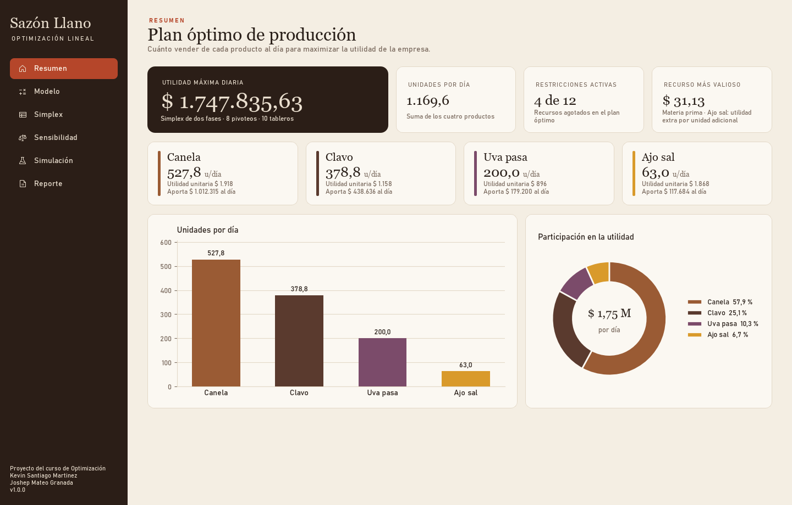
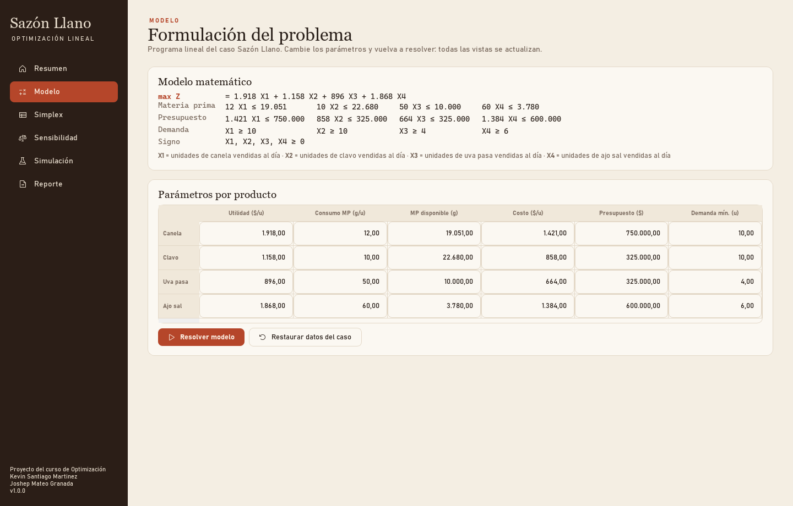
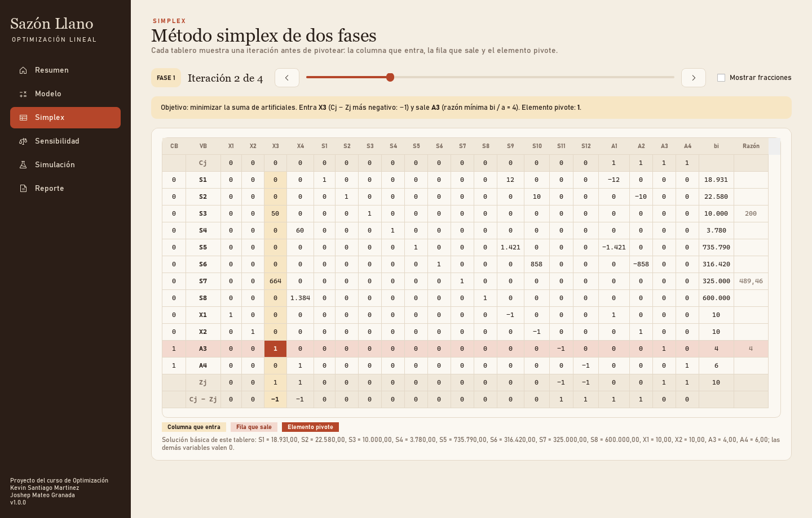
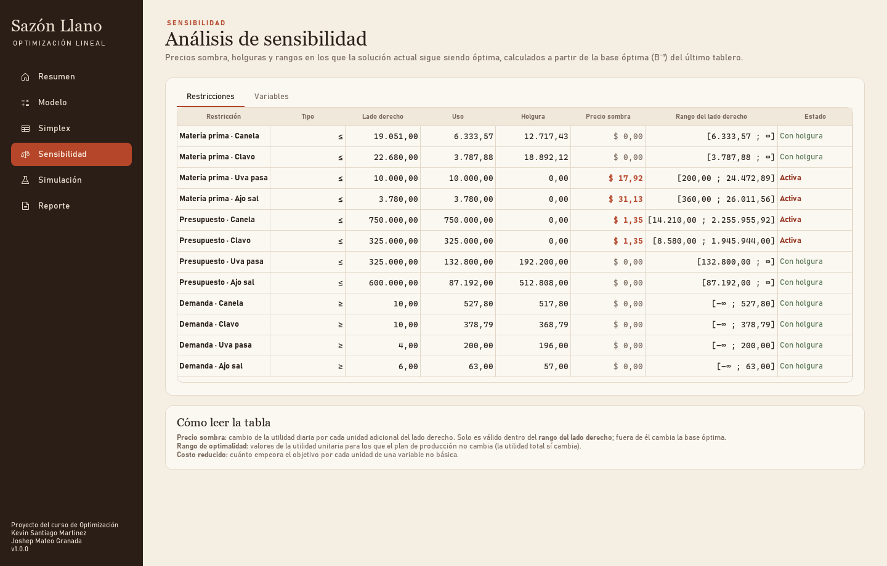
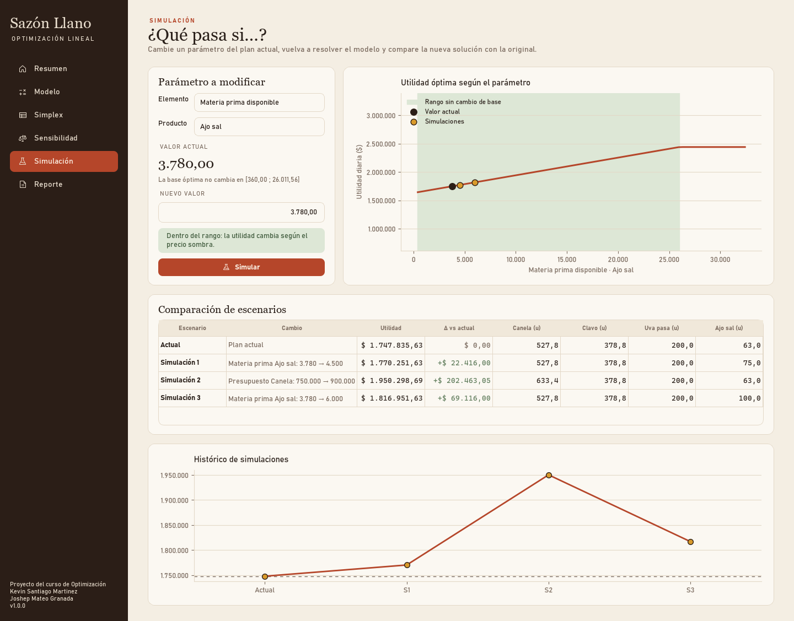
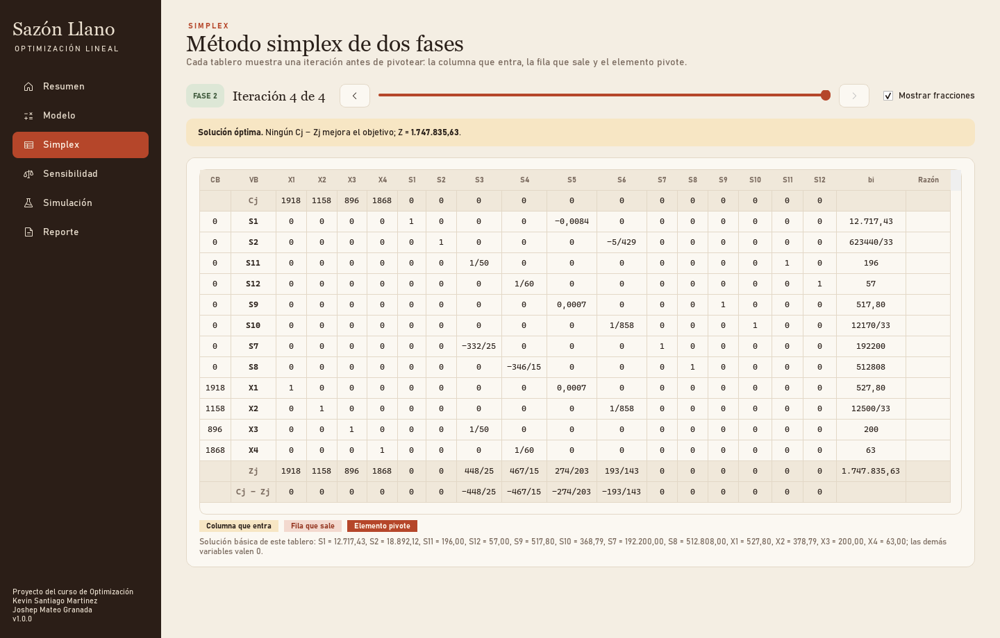
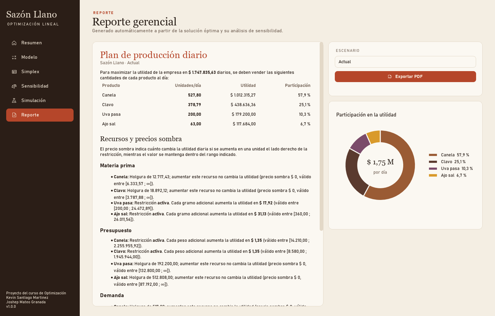

# Sazón Llano — Optimización lineal

Aplicación de escritorio que resuelve el plan de producción diario de **Sazón Llano**, una empresa de especias,
con **programación lineal**: formula el modelo, lo resuelve con el **método simplex de dos fases** mostrando cada
tablero, calcula el **análisis de sensibilidad** (precios sombra y rangos) y permite simular escenarios
"¿qué pasa si…?" y generar un reporte gerencial.

Proyecto del curso de **Optimización**: versión final `1.0.0`.



## El problema

La empresa vende cuatro productos (canela, clavo, uva pasa y ajo sal) y decide cuántas unidades `Xi` vender al
día para maximizar la utilidad, sujeta a la materia prima disponible, al presupuesto de cada producto y a una
demanda mínima:

```text
max Z = 1918 X1 + 1158 X2 + 896 X3 + 1868 X4

Materia prima (g)   12 X1 ≤ 19 051     10 X2 ≤ 22 680     50 X3 ≤ 10 000     60 X4 ≤ 3 780
Presupuesto ($)   1421 X1 ≤ 750 000   858 X2 ≤ 325 000   664 X3 ≤ 325 000  1384 X4 ≤ 600 000
Demanda (u)            X1 ≥ 10             X2 ≥ 10             X3 ≥ 4             X4 ≥ 6
                       X1, X2, X3, X4 ≥ 0
```

Solución óptima: **Z = $ 1.747.835,63** diarios vendiendo 527,80 u de canela, 378,79 u de clavo, 200 u de uva
pasa y 63 u de ajo sal. Los recursos que limitan la utilidad son la materia prima de uva pasa
(precio sombra $ 17,92 por gramo) y de ajo sal ($ 31,13 por gramo) y el presupuesto de canela y de clavo
($ 1,35 por peso).

## Características

- **Modelo editable**: la formulación se muestra en notación matemática y cada parámetro (utilidad, consumo y
  stock de materia prima, costo, presupuesto, demanda) se puede cambiar y volver a resolver.
- **Simplex de dos fases paso a paso**: un tablero por iteración con `Cj`, `CB`, `VB`, `Zj`, `Cj − Zj`, la
  columna que entra, la razón mínima, la fila que sale y el elemento pivote resaltados, una explicación de cada
  paso y la opción de ver los valores como fracciones.
- **Análisis de sensibilidad** calculado a partir de la base óptima (`B⁻¹`): precios sombra, holguras,
  restricciones activas, costos reducidos, rangos del lado derecho y rangos de optimalidad.
- **Simulación**: cambia un parámetro, compara el nuevo plan con el actual y muestra la curva de utilidad óptima
  en función del parámetro con el rango en el que la base no cambia.
- **Reporte gerencial** generado a partir de la solución (de cualquier escenario) y exportable a PDF.

| | |
|---|---|
|  |  |
|  |  |
|  |  |

## Requisitos

- Python 3.12 o superior (probado con 3.13).
- Windows, Linux o macOS con entorno gráfico.

## Instalación y ejecución

```bash
python -m venv .venv
# Windows: .venv\Scripts\activate    Linux/macOS: source .venv/bin/activate
pip install -r requirements.txt
pip install -e . --no-deps

sazon-llano                 # o: python -m optimizacion
sazon-llano --no-splash     # abre la ventana principal sin la pantalla de carga
```

`requirements.txt` fija todas las dependencias (incluidas las transitivas) a versiones publicadas en PyPI;
`pyproject.toml` declara las dependencias directas.

## Pruebas

```bash
pip install -r requirements-dev.txt
pip install -e . --no-deps
pytest
```

La suite (120 pruebas) cubre:

- **Simplex**: problemas de libro (Wyndor Glass de Hillier y Lieberman, problema de dieta), restricciones `=`,
  lados derechos negativos, infactibilidad, no acotamiento, filas redundantes, el ejemplo de ciclado de Beale y
  60 problemas aleatorios comparados con **SciPy/HiGHS** como oráculo independiente.
- **Sensibilidad**: valores de libro, precios sombra frente a los multiplicadores de HiGHS y 25 problemas
  aleatorios en los que se verifica con SciPy que dentro de cada rango la utilidad cambia exactamente según el
  precio sombra y la solución sigue siendo óptima.
- **Caso de estudio**: solución, precios sombra y rangos contrastados con el reporte de CPLEX del proyecto
  original, simulaciones, curva paramétrica y reporte.
- **Interfaz**: navegación, tableros, simulación, edición del modelo, casos infactibles y exportación a PDF
  (ejecutada sin pantalla con `QT_QPA_PLATFORM=offscreen`).

Las capturas de `docs/screenshots` se generan desde la aplicación real con:

```bash
QT_QPA_PLATFORM=offscreen python scripts/capture_screenshots.py
```

## Arquitectura

```text
src/optimizacion/
├── core/                 lógica pura, sin dependencias de Qt
│   ├── model.py          LinearProgram, Constraint, Sense, Goal
│   ├── simplex.py        forma estándar y simplex de dos fases con registro de tableros
│   ├── sensitivity.py    precios sombra, costos reducidos y rangos a partir de B⁻¹
│   ├── case_study.py     datos y modelo del caso Sazón Llano
│   ├── scenarios.py      evaluación, simulaciones y curva paramétrica
│   ├── report.py         reporte gerencial en HTML
│   └── formatting.py     números con formato colombiano (1.234,56)
├── ui/                   interfaz PySide6
│   ├── theme.py          paleta, tipografía y hoja de estilos
│   ├── state.py          estado compartido (escenario base e historial)
│   ├── charts.py         gráficas de Matplotlib con el tema de la aplicación
│   ├── tableau_model.py  modelo Qt que pinta un tablero simplex
│   ├── pages/            Resumen, Modelo, Simplex, Sensibilidad, Simulación, Reporte
│   ├── main_window.py    barra lateral y navegación
│   └── splash.py         pantalla de carga
└── app.py                punto de entrada (sazon-llano / python -m optimizacion)
```

Detalles del método:

- Las restricciones con lado derecho negativo se multiplican por −1; las `≤` reciben holgura `S`, las `≥` exceso
  `S` y artificial `A`, y las `=` solo artificial.
- La fase 1 minimiza la suma de artificiales; si termina con valor positivo el problema es infactible. Las
  artificiales que quedan en la base con valor cero se sacan con un pivote y las filas redundantes se eliminan.
- La fase 2 elige la columna con el mejor `Cj − Zj` (regla de Dantzig) y, tras varios pivoteos degenerados,
  cambia a la regla de Bland para no ciclar. Si ninguna fila admite razón, el problema no está acotado.

## Cambios en la versión 1.0.0

La versión original tenía el tablero inicial escrito a mano, dependía de CPLEX (software propietario) para la
sensibilidad, el reporte era un texto fijo y la interfaz usaba PyQt5 con 287 íconos sin usar. En esta versión:

- El simplex es general y se valida contra SciPy. Se corrigió el criterio de optimalidad de la fase 2 (revisaba
  `Zj ≥ 0` en lugar de `Cj − Zj ≤ 0`), la prueba de razón (aceptaba coeficientes no positivos) y se añadió la
  detección de problemas infactibles y no acotados.
- La sensibilidad se calcula desde la base óptima, sin CPLEX.
- Las restricciones de demanda eran inconsistentes entre el tablero (`X ≥ d`) y el modelo de CPLEX
  (`12 X ≥ d`); se unificaron como `X ≥ d` (unidades). El plan óptimo no cambia porque la demanda no es activa.
- El reporte, los valores de la pantalla de inicio y las gráficas se generan a partir de la solución.
- Interfaz reescrita en PySide6 con identidad visual propia, íconos de QtAwesome y empaquetado con
  `pyproject.toml`.

## Contexto académico

Proyecto del curso de Optimización (2022) desarrollado por Kevin Santiago Martinez y Joshep Mateo Granada:
formulación de un modelo de programación lineal para una empresa real, solución con simplex de dos fases y
análisis de sensibilidad para la toma de decisiones.

## Licencia

[MIT](LICENSE)
